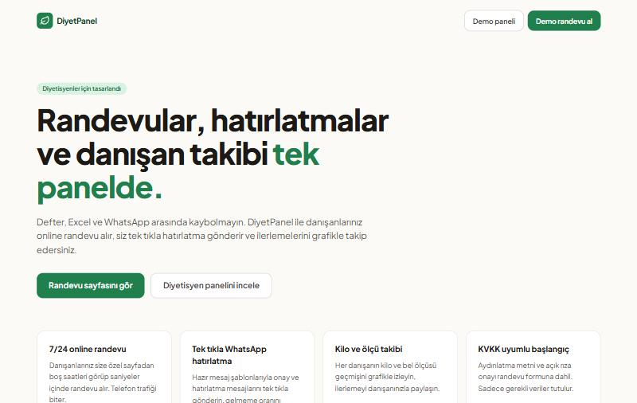
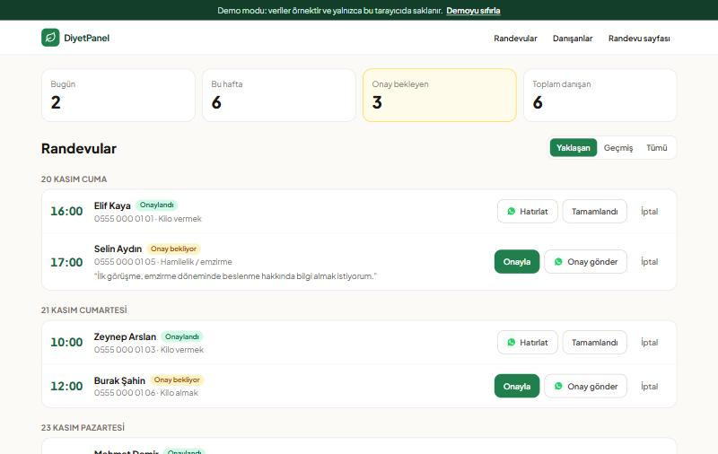
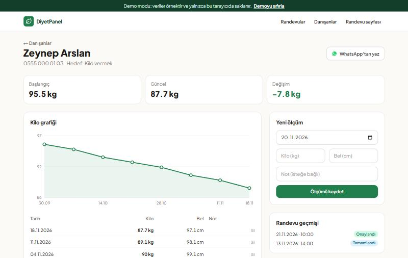
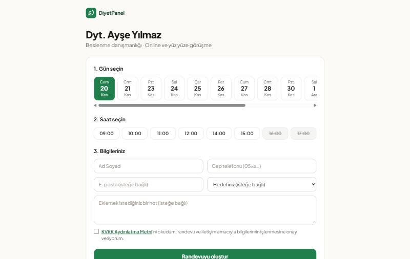

<div align="center">

# 🌿 DiyetPanel

**Diyetisyenler için online randevu, WhatsApp hatırlatma ve danışan takip sistemi**

### [🔗 Canlı Demoyu Görüntüle → diyetpanel.vercel.app](https://diyetpanel.vercel.app)




</div>

---

## 📌 Proje Hakkında

DiyetPanel, serbest çalışan diyetisyenlerin günlük işlerini kolaylaştırmak için geliştirilmiş bir web uygulamasıdır.

Pek çok diyetisyen randevularını hâlâ telefon, defter ve WhatsApp mesajlarıyla yönetiyor. Bu da randevu karışıklığına, unutulan seanslara ve danışan ilerlemesinin takip edilememesine yol açıyor. DiyetPanel bu sorunu üç parçada çözer:

1. **Danışan tarafı:** Danışan, diyetisyene özel sayfadan boş saatleri görüp kendisi randevu alır.
2. **Diyetisyen paneli:** Diyetisyen gelen randevuları onaylar ve tek tıkla WhatsApp'tan onay veya hatırlatma mesajı gönderir.
3. **Danışan takibi:** Her danışanın kilo ve bel ölçüleri kaydedilir, ilerleme grafikle gösterilir.

> **Not:** Bu proje bir demo/ödev projesidir. Sunucu veya veritabanı kullanılmaz. Tüm veriler ziyaretçinin **kendi tarayıcısında (localStorage)** saklanır, hiçbir bilgi bir sunucuya gönderilmez. Siteyi ilk açtığınızda örnek danışan ve randevu verileri otomatik yüklenir. Panelin üstündeki **"Demoyu sıfırla"** bağlantısıyla her zaman başa dönebilirsiniz.

## 🖼️ Ekran Görüntüleri

| Diyetisyen Paneli | Danışan Detayı ve Kilo Grafiği |
| :---: | :---: |
|  |  |

| Online Randevu Sayfası |
| :---: |
|  |

## ✨ Özellikler

### Danışan tarafı
- 📅 Pazar hariç önümüzdeki 14 gün için gün ve saat seçimi
- 🚫 Dolu ve geçmiş saatler otomatik kapanır, aynı saate iki randevu alınamaz
- 📝 Ad, telefon, e-posta, beslenme hedefi ve not girişi
- ✅ Telefon numarası doğrulama (05xx formatı)
- 🔒 KVKK aydınlatma metni ve onay kutusu

### Diyetisyen paneli
- 📊 Özet kartları: bugünkü, bu haftaki ve onay bekleyen randevular, toplam danışan
- 🗂️ Randevuların güne göre gruplanması; Yaklaşan / Geçmiş / Tümü sekmeleri
- 🔄 Randevu durumları: *Onay bekliyor → Onaylandı → Tamamlandı* veya *İptal*
- 💬 **Tek tıkla WhatsApp:** Danışanın adı, randevu günü ve saatiyle hazırlanmış onay ve hatırlatma mesajı WhatsApp'ta açılır
- 🔍 Danışan listesinde isim veya telefonla arama

### Danışan takibi
- ⚖️ Kilo ve bel ölçüsü kaydı (virgüllü veya noktalı sayı girilebilir)
- 📈 Kütüphane kullanmadan SVG ile çizilmiş kilo değişim grafiği
- 🎯 Başlangıç, güncel kilo ve toplam değişim kartları
- 🕓 Randevu geçmişi

## 🛠️ Kullanılan Teknolojiler

| Teknoloji | Kullanım amacı |
| --- | --- |
| **Next.js 16 (App Router)** | Sayfa yönlendirme, statik sayfa üretimi |
| **React 19** | Arayüz bileşenleri, `useSyncExternalStore` ile veri yönetimi |
| **TypeScript** | Tip güvenliği |
| **Tailwind CSS 4** | Tasarım ve mobil uyumluluk |
| **localStorage** | Tarayıcıda veri saklama |
| **Intl API** | Türkçe tarih/saat biçimlendirme, İstanbul saat dilimi |
| **Vercel** | Yayınlama (her `git push` sonrası otomatik deploy) |

Grafik, ikonlar ve form doğrulama için harici kütüphane kullanılmadı. Bu sayede proje hafif kaldı ve sayfaların çoğu statik olarak üretiliyor.

## 📁 Proje Yapısı

```
src/
├── app/
│   ├── page.tsx                  # Tanıtım (ana) sayfası
│   ├── randevu/                  # Danışanların randevu aldığı sayfa
│   ├── panel/
│   │   ├── page.tsx              # Randevu yönetimi ve özet kartları
│   │   └── danisanlar/
│   │       ├── page.tsx          # Danışan listesi ve arama
│   │       └── [id]/             # Danışan detayı, ölçümler, grafik
│   └── kvkk/                     # KVKK aydınlatma metni
├── components/ui.tsx             # Ortak arayüz bileşenleri
└── lib/
    ├── store.ts                  # Veri katmanı (localStorage + örnek veriler)
    └── utils.ts                  # Tarih, telefon, WhatsApp mesajı yardımcıları
```

## 🚀 Kurulum (Yerelde Çalıştırma)

Gereksinim: [Node.js](https://nodejs.org) 20 veya üzeri

```bash
git clone https://github.com/enescivelek0/diyetpanel.git
cd diyetpanel
npm install
npm run dev
```

Ardından tarayıcıda [http://localhost:3000](http://localhost:3000) adresini açın. Ek bir ayar veya veritabanı kurulumu gerekmez.

## 🧪 Nasıl Denenir?

1. [Canlı demoda](https://diyetpanel.vercel.app) **"Randevu sayfasını gör"** butonuna tıklayın ve bir randevu oluşturun.
2. **"Diyetisyen panelinde gör"** ile panele geçin. Randevunuz *Onay bekliyor* olarak görünür.
3. **Onayla** butonuna basın, ardından **Hatırlat** ile hazır WhatsApp mesajını görün.
4. **Danışanlar** sekmesinden bir danışana girip yeni bir kilo ölçümü ekleyin. Grafik anında güncellenir.

## 🔮 Geliştirme Fikirleri

- [ ] Gerçek veritabanı ve diyetisyen girişi (çoklu kullanıcı)
- [ ] WhatsApp Business API ile otomatik hatırlatma
- [ ] Diyet listesi hazırlama ve PDF olarak paylaşma
- [ ] Danışanın su ve öğün takibi yapabileceği mobil uygulama (PWA)

## 👤 Geliştirici

**[@enescivelek0](https://github.com/enescivelek0)**

---

<div align="center">
⭐ Projeyi beğendiyseniz yıldız vermeyi unutmayın!
</div>
